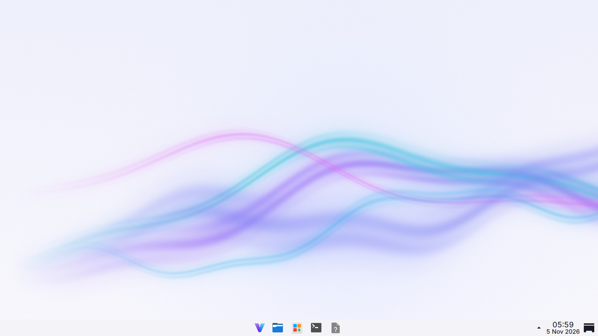
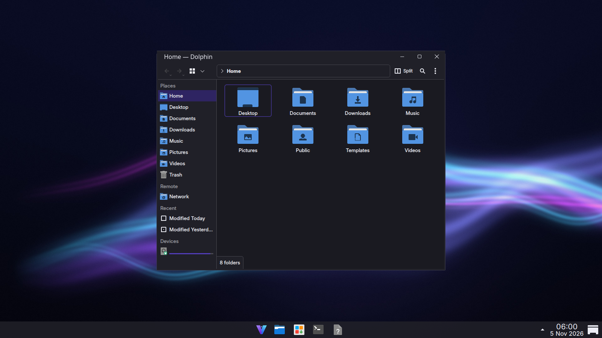
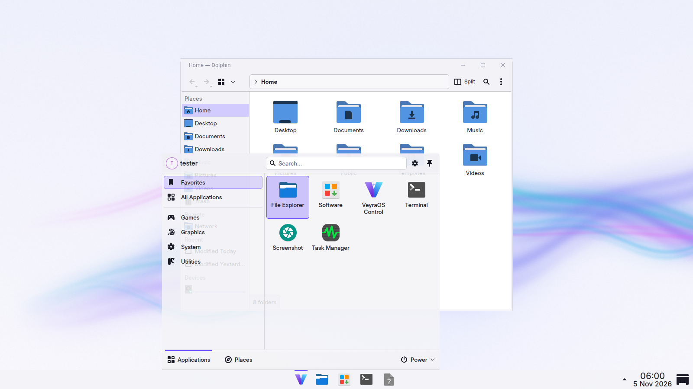
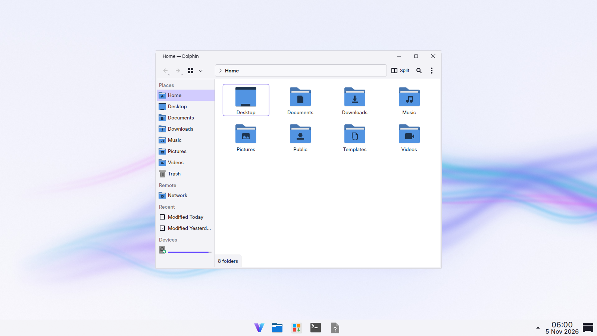

# VeyraOS

**A Windows-familiar desktop operating system built on Artix Linux (OpenRC — no systemd) and KDE Plasma 6, tuned for gaming on NVIDIA hardware.**

Start menu, centered taskbar, File Explorer, Task Manager, Windows shortcuts and a one-click Software store — on a fast, private, rolling Linux base with Steam/Proton, Lutris, Gamescope, MangoHud and GameMode preinstalled.

| Light | Dark |
|---|---|
|  |  |
|  |  |

*Screenshots are real renders of the VeyraOS packages in a Plasma 6.6 session (software rendering, so no window shadows/blur). See [docs/TESTING.md](docs/TESTING.md).*

---

## Project status: Release Candidate 1 (2026.11 "Aurora") — read this first

Everything in this repository is real, version-controlled and tested as far as
the development environment allowed. **The complete ISO has not yet been built**,
because the environment this was developed in cannot reach the Artix/Arch package
mirrors. The build is automated and runs anywhere with Docker and internet
(`make iso`) or on GitHub Actions (`.github/workflows/build-iso.yml`).

| Area | State | Verified how |
|---|---|---|
| ISO build system (`build/`) | Complete | Stages exercised piecewise; full run needs mirror access |
| Live boot (GRUB BIOS+UEFI, squashfs/overlay hook) | Complete | **QEMU boot tests pass**: BIOS, UEFI, copy-to-RAM, integrity check, text mode — booting Artix OpenRC userland with VeyraOS services |
| OpenRC services (zram, firewall, first boot, live) | Complete | Started and checked **inside the booted QEMU system** |
| VeyraOS packages (8 PKGBUILDs) | Complete | Built with `makepkg` and installed with `pacman` in official Artix containers |
| Desktop (Plasma layout, themes, decoration, shortcuts) | Complete | **Rendered in a real Plasma 6.6 session**; bugs found there were fixed |
| Apps: Control, Software, Updates, Welcome, Gaming Mode | Complete | Unit tests + GUI smoke tests + screenshots |
| Installer (Calamares) | Configured | Loaded by **Calamares 3.3.14** with no config errors; a full disk install still needs a VM run of the real ISO |
| NVIDIA (RTX 50 series) | Configured | Detection logic unit-tested with real PCI IDs; needs real hardware |
| Gaming stack | Configured | Package set + configs; needs real hardware |

Known gaps and their workarounds: [docs/KNOWN-ISSUES.md](docs/KNOWN-ISSUES.md).
Full development history and decisions: [docs/DEVLOG.md](docs/DEVLOG.md).

## Quick start

```bash
# Build the ISO (any Linux with Docker and internet; ~25 GB disk, 30-90 min)
make iso                      # -> out/veyraos-2026.11-rc1-x86_64.iso (+ .sha256, package manifest, log)

# Run the test suites
make test                     # static checks, shellcheck, unit + GUI tests (seconds)
make test-packaging           # build + install every VeyraOS package in Artix containers
make test-boot                # QEMU live-boot tests (BIOS/UEFI/RAM/verify/text mode)
make test-desktop             # render the desktop in Plasma 6 and take screenshots
```

Write the ISO to a USB stick and boot it: [docs/INSTALLATION.md](docs/INSTALLATION.md).

## What you get

- **Desktop:** KDE Plasma 6 with a Windows 11-style layout: centered Start button and taskbar, system tray, clock with date, "peek at desktop" corner; Windows-style title bar buttons; snapping (Meta+arrows); Task View (Meta+Tab); Alt+Tab thumbnail grid; light and dark themes that switch together with the title bars.
- **Familiar names:** File Explorer, Task Manager, Settings, Terminal, Screenshot, Photos, Calculator, Disk Management…
- **Apps:** Firefox (telemetry off), Dolphin, Konsole, Kate, Okular, Gwenview, Spectacle, Ark, plus VeyraOS **Control**, **Software**, **Updates**, **Welcome** and **Gaming Mode**.
- **Gaming:** Steam (Proton / Proton Experimental), Lutris, Gamescope, MangoHud, GameMode, Wine, Vulkan (incl. 32-bit), ntsync, controller support; Gaming Mode (Meta+G).
- **NVIDIA:** proprietary driver with the open kernel modules (required for RTX 50 series), DKMS for both kernels, Wayland-ready KMS settings, suspend/resume hooks for OpenRC, NVIDIA Settings, VA-API, optional CUDA; automatically removed on non-NVIDIA PCs.
- **Installer:** Calamares — alongside Windows, replace partition, erase disk, or manual; btrfs with restore points (Timeshift) by default; LUKS encryption option; never erases anything without explicit confirmation.
- **Security & privacy:** nftables firewall (deny inbound), signed packages only, official repositories only, no telemetry, polkit-gated admin actions, optional automatic updates, restore points before updates.
- **Performance:** zram swap, lean OpenRC service set, empty-session login, file-name-only search indexing; no speculative kernel "tweaks".

## Repository layout

```
build/            ISO builder (build-iso.sh, Docker wrapper, chroot configuration, GRUB/ISO library)
packages/         package manifests (*.list) with alternatives/optional entries
pkgbuilds/        PKGBUILDs for the VeyraOS packages (+ fallback Calamares build)
src/              package contents:  branding/ system/ desktop/ nvidia/ gaming/ apps/ live/ installer/
tools/            artwork generators (wallpapers, sounds, GRUB/Plymouth, decorations), benchmark script
tests/            static/ unit/ packaging/ boot/ desktop/ test suites
docs/             documentation (start with ARCHITECTURE.md)
.github/workflows CI: tests on every push; ISO build + boot check + release on tags
```

## Documentation

| | |
|---|---|
| [ARCHITECTURE](docs/ARCHITECTURE.md) | How VeyraOS is put together and why |
| [BUILDING](docs/BUILDING.md) | Building the ISO, customizing it, reproducibility |
| [INSTALLATION](docs/INSTALLATION.md) | USB, firmware settings (MSI B840), dual boot with Windows |
| [DESKTOP](docs/DESKTOP.md) | Windows equivalents, shortcuts, theming |
| [NVIDIA](docs/NVIDIA.md) | RTX 50 series, Wayland, CUDA, troubleshooting |
| [GAMING](docs/GAMING.md) | Steam/Proton, Lutris, Gaming Mode, **anti-cheat compatibility** |
| [SECURITY](docs/SECURITY.md) | Firewall, updates, privacy, Secure Boot |
| [PERFORMANCE](docs/PERFORMANCE.md) | What is tuned, what is not, how to benchmark |
| [RECOVERY](docs/RECOVERY.md) | When something goes wrong |
| [TESTING](docs/TESTING.md) | What each test proves (and doesn't) |
| [KNOWN-ISSUES](docs/KNOWN-ISSUES.md) | Limitations and open items |
| [RELEASE-NOTES](docs/RELEASE-NOTES.md) | 2026.11 RC1 |
| [DEVLOG](docs/DEVLOG.md) | Development log |

## License

Code: GPL-3.0-or-later. Artwork (logo, wallpapers, sounds, themes): CC BY-SA 4.0.
GRUB theme fonts are renderings of Inter (SIL OFL 1.1). See [LICENSE](LICENSE) and [LICENSES/](LICENSES/).
VeyraOS is an independent project built on Artix Linux, Arch Linux and KDE; it is not affiliated with or endorsed by them or by Microsoft.
